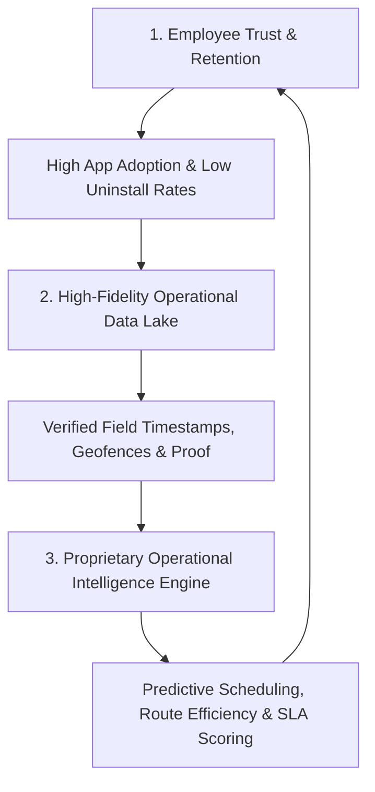

# Oprino Competitive Positioning & Market Strategy

**Document:** Competitive Landscape, Differentiation & Moat Analysis  
**Phase:** 00 — Pre-Development Freeze (Final Reconciliation)  
**Status:** Documented & Verified Against Current Product Plan (Subject to Stakeholder Approval)  
**Primary Competitors Analyzed:** TaskOPad, Unolo

---

## 1. Executive Summary & Market Gap

The SMB workforce management software market in emerging and developing markets is divided into two polarized camps:

```
    ┌───────────────────────────┐         ┌───────────────────────────┐
    │         TaskOPad          │         │           Unolo           │
    │  Task & Work Management   │         │    Field-Force Tracking   │
    │                           │         │                           │
    │ • Great task checklists   │         │ • Live GPS tracking       │
    │ • Recurring workflows     │   VS    │ • Beat / route planning   │
    │ • WEAK field tracking     │         │ • Field attendance        │
    │ • WEAK visit verification │         │ • WEAK task depth         │
    │ • Desktop-first mindset   │         │ • Aggressive surveillance │
    └─────────────┬─────────────┘         └─────────────┬─────────────┘
                  │                                     │
                  └──────────────────┬──────────────────┘
                                     ▼
                    ┌─────────────────────────────────┐
                    │             OPRINO              │
                    │   The Unified Sweet Spot        │
                    │                                 │
                    │ • Task-management quality       │
                    │ • Field-force visibility        │
                    │ • Simpler, modern SMB UX        │
                    │ • Privacy-first duty tracking   │
                    └─────────────────────────────────┘
```

SMB business owners (5–500 employees; core sweet spot: 10–200 employees) across diverse mobile and distributed operations (field service, installation, inspection, facility management, distribution, sales, and multi-site ops) currently face a dilemma:
- If they adopt a **task tool (TaskOPad, Asana, ClickUp)**, they get structured task assignment but cannot verify where their mobile team actually went, whether they reached client or site locations, or how many hours were spent on duty.
- If they adopt a **field-tracking tool (Unolo, FieldAssist, TrackoField)**, they get heavy GPS tracking, but the software treats workers as delivery dots on a map rather than operators with structured task checklists, proof requirements, and clear daily priorities. Furthermore, employees resist installation due to fear of 24/7 surveillance and battery drain.

**Oprino wins across multi-industry SMBs by uniting task-management depth with respectful, duty-hours field operations.**

---

## 2. In-Depth Competitor Breakdown

### 2.1 TaskOPad Audit
- **Core Strengths:**
  - Robust structured task hierarchies, subtasks, and checklists.
  - Good recurring task automation for routine jobs.
  - Built-in task comments and activity logging.
  - Project grouping and deadline tracking.
- **Critical Vulnerabilities & Limitations:**
  - **Weak Field Verification:** Little to no robust GPS-based site visit check-in or client-location verification.
  - **No Real-Time Field Operations Map:** Incapable of showing where distributed workers are right now during work hours.
  - **Desktop-First UX:** Mobile app feels like an afterthought; clunky for mobile staff operating one-handed in the field.
  - **No Geofenced Proof:** Photo proof lacks embedded location and timestamp verification.

### 2.2 Unolo Audit
- **Core Strengths:**
  - High-precision real-time GPS tracking and historical breadcrumbs.
  - Field attendance with geofencing and facial recognition.
  - Automated conveyance and travel expense distance calculations.
  - Beat planning and field sales order forms.
- **Critical Vulnerabilities & Limitations:**
  - **Shallow Task Capabilities:** Tasks in Unolo are rudimentary check-offs tied only to a customer visit. Cannot handle complex internal, multi-stage, or collaborative workflows.
  - **Employee Resentment & Surveillance Pushback:** Workers frequently push back against invasive 24/7 tracking perception.
  - **Bloated Enterprise Feature Creep:** Overloaded with sales order booking, distributor schemes, and CRM features that overwhelm standard SMB service and operations companies.
  - **Battery Drain:** Aggressive continuous background GPS polling rapidly drains mobile device batteries.

---

## 3. Oprino Parity Requirements (Table Stakes)

To be evaluated and adopted by prospective SMB clients, Oprino must achieve parity on essential operational primitives:

| Category | Table Stakes Feature | Competitor Standard | Oprino Implementation |
|---|---|---|---|
| **Attendance** | GPS & Selfie Punch In/Out | Unolo, TaskOPad | Native camera capture + coordinate validation. |
| **Visibility** | Live Map & Breadcrumb Trail | Unolo | Duty-hours operational overview and breadcrumbs. |
| **Tasks** | Checklists, Priorities, Due Dates | TaskOPad | Rich task model with default 7-stage workflow. |
| **Proof** | Watermarked Photo Proof | Unolo | Embedded timestamp, coordinates, and task reference. |
| **Reporting** | Attendance & Task Excel/PDF Export| Both | One-click daily/monthly operational exports. |
| **Mobile** | Native Android & iOS Apps | Both | High-performance, offline-first mobile apps. |

---

## 4. Oprino Differentiation Opportunities (Where Oprino Wins)

### 4.1 Privacy-First Duty-Hours Tracking (The Trust Engine)
- **The Problem in the Market:** Worker pushback stems from fear of management monitoring them after hours or on weekends.
- **The Oprino Advantage:** Oprino legally and architecturally guarantees that location ingestion halts the moment an employee punches out.
- **Clear Tracking State Visibility:** The employee app ensures workers always know whether tracking is **ON** or **OFF**, when tracking started, when tracking stopped, and the company policy. *(Persistent status banner is a UX candidate).*

### 4.2 Seamless Decoupling of Tasks vs Visits
- In TaskOPad, visits don't exist. In Unolo, tasks are subservient to client visits.
- **Oprino’s Architectural Breakthrough:** Tasks and Visits are separate, composable primitives:
  - An internal maintenance task may require **no visits**.
  - A client servicing task may require **one visit**.
  - A multi-site inspection task may require **multiple visits** across different locations under the same work order.

### 4.3 Clean, Modern SMB Experience (Zero-Training Onboarding)
- Oprino utilizes a crisp, accessible design system (Space Grotesk headings, Manrope UI, Cobalt action buttons, Paper surfaces).
- An SMB owner can create an account, upload a 50-person employee CSV, and have workers punching in within minutes.

### 4.4 Offline-First Reliability
- Competitors often freeze when a worker loses cellular connectivity inside basements or remote facilities.
- Oprino supports offline-first execution of core workflows (viewing assigned tasks, status changes, checklist updates, photo proof, signatures, and attendance events), with reliable conflict-aware synchronization after connectivity returns.

---

## 5. Strategic Traps & Features to Avoid

To prevent feature creep, Oprino explicitly rejects copying competitor bloat:

1. **Avoid Sales CRM Pipelines:** Do not build deal stages, lead scoring, or email marketing (Unolo trap). Oprino is an operations execution tool.
2. **Avoid Full Order & Inventory Booking:** Do not build wholesale SKU order forms, price lists, or warehouse dispatch modules.
3. **Avoid Complex Agile / PM Visualizations:** Do not build Gantt charts, burndown curves, or complex sprint planning (TaskOPad / ClickUp trap).
4. **Avoid In-App P2P Chat Rooms:** Do not attempt to replace general chat apps. Keep communication strictly tethered to task comments and operational context.

---

## 6. Long-Term Moats



1. **The Trust Moat (Worker Buy-in):** Because Oprino respects worker privacy and protects battery life during off-duty hours, workers do not disable permissions or spoof locations. Cleaner data yields superior management insights.
2. **The Verification Moat (Proof of Work):** Completed work is backed by tamper-resistant proof (watermarked photos, client signatures, proximity check). This makes Oprino indispensable for client billing verification and SLAs.
3. **The Workflow Lock-In:** Once an SMB integrates its daily duty schedules, customer site coordinates, recurring checklists, and manager approvals into Oprino, switching costs are exceptionally high.
