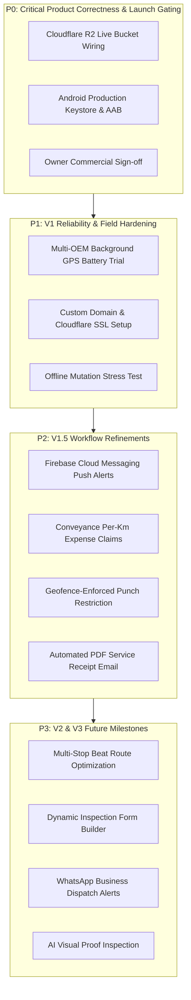

# OPRINO — Zero-Duplicate Gap Analysis & Execution Roadmap

**Document Status:** AUTHORITATIVE & EVIDENCE-BACKED  
**Classification:** Research-Driven Gap Matrix, Backlog & Roadmap Alignment  
**Audience:** Technical Leadership, Full-Stack & Mobile Engineers, AI Assistants  
**Date of Alignment:** October 2026  
**Controlling Master PRD:** [`docs/product/OPRINO-MASTER-PRD.md`](./OPRINO-MASTER-PRD.md)  
**Controlling Architecture:** [`docs/architecture/OPRINO-TECHNICAL-ARCHITECTURE.md`](../architecture/OPRINO-TECHNICAL-ARCHITECTURE.md)  

---

## 1. Feature Classification Matrix (Codebase vs. Competitor Research)

This matrix compares competitor capabilities observed in TaskOPad and Unolo research against Oprino's actual implementation evidence:

| Capability / Workflow | Competitor Context (TaskOPad / Unolo) | Oprino Implementation Evidence & Status | Status Classification |
|---|---|---|---|
| **Multi-Tenant Horizontal Isolation** | Unolo & TaskOPad use standard org IDs without documented DB-level RLS. | Fastify API injects `SET LOCAL app.current_workspace_id` in Drizzle transactions. PostgreSQL 17 RLS verified across 29 tables via `services/api/test/tenant-isolation.test.ts`. | **IMPLEMENTED & VERIFIED** |
| **Authentication & Device Governance** | TaskOPad uses basic JWT; Unolo uses mobile device IDs. | Better Auth with Bearer plugin for mobile. Cryptographically random UUIDv4 installation tokens stored in `flutter_secure_storage`. Server-side device revocation tested in `device-governance.unit.test.ts`. | **IMPLEMENTED & VERIFIED** |
| **Selfie & GPS Duty Punch In/Out** | Unolo uses proprietary "Facelock"; TaskOPad has simple button. | 1-tap punch in/out with live camera selfie capture (`apps/mobile/lib/features/attendance/`), GPS coordinates, and server duration computation (`POST /v1/attendance/punch-in`). | **IMPLEMENTED & VERIFIED** |
| **Duty-Hours-Only Location Tracking** | Unolo runs 24/7 background tracking (high privacy friction); TaskOPad lacks real-time GPS. | Mobile client synchronously unhooks GPS on punch-out. API endpoint `POST /v1/telemetry/points` drops off-duty coordinates with 0 DB writes. Tested in `services/api/test/telemetry.test.ts`. | **IMPLEMENTED & VERIFIED** |
| **Peer Location Opacity** | Unolo allows manager/dispatcher tracking. | Peer visibility is strictly **OFF by default** (`location.read` permission restricted to Managers/Admins). Enforced in `services/api/src/routes/telemetry.ts`. | **IMPLEMENTED & VERIFIED** |
| **Real-Time Live Radar Map** | Unolo has web live map; TaskOPad has static attendance table. | Web Dashboard `/live-map` connects to SSE stream (`/v1/telemetry/stream`) backed by Upstash Redis Pub/Sub. Real-time SVG rendering with worker inspector. | **IMPLEMENTED & VERIFIED** |
| **30-Day Location Retention Pruning** | Unolo retains GPS indefinitely (storage bloat). | Scheduled BullMQ worker job `telemetry.retention.prune` invokes `telemetry_prune_expired_records(30)` daily, aggregating daily travel distance. | **IMPLEMENTED & VERIFIED** |
| **7-Stage Task State Lifecycle** | TaskOPad uses Kanban board; Unolo uses simple status dropdown. | State transitions: `ASSIGNED` → `ACCEPTED` → `EN_ROUTE` → `ARRIVED` → `IN_PROGRESS` → `COMPLETED` → `VERIFIED` with optimistic version concurrency checks (HTTP 409). | **IMPLEMENTED & VERIFIED** |
| **Mandatory Step-by-Step Checklists** | TaskOPad checklists are optional text items. | Strict invariant: tasks cannot transition to `COMPLETED` if required checklist items are unfinished. Enforced at API schema level (`POST /v1/tasks/:id/transition`). | **IMPLEMENTED & VERIFIED** |
| **On-Glass Customer Signatures** | Missing in TaskOPad; proprietary in Unolo. | Mobile `CustomerSignatureSheet` tracks raw touch points via Flutter Listener and generates high-resolution PNG proof watermarked with timestamp and GPS coordinates. | **IMPLEMENTED & VERIFIED** |
| **Watermarked Photo Proofs** | Unolo camera capture; TaskOPad file attachment. | Mobile `PhotoProofSheet` embeds live GPS coordinates, accuracy, and timestamp directly onto captured camera image bytes before S3/R2 upload. | **IMPLEMENTED & VERIFIED** |
| **Supervisor Verification Queue** | Missing in TaskOPad (honor system). | Completed tasks flow into dedicated manager review inbox (`/tasks/verification`). Manager approves (`VERIFIED`) or rejects with reason (`REJECTED`). | **IMPLEMENTED & VERIFIED** |
| **Offline-First Drift SQLite Outbox** | Unolo has basic HTTP retry; TaskOPad requires active internet. | Flutter app persists all offline mutations into Drift SQLite tables. `SyncEngine` drains outbox upon connectivity restoration using conflict resolution rules. | **IMPLEMENTED & VERIFIED** |
| **Dispatch Stop Sequencing** | Unolo offers beat planning (PJP) for sales. | Oprino supports sequential daily site visits with `PUT /v1/visits/sequence` and interactive reordering in web and mobile views. | **IMPLEMENTED & VERIFIED** |
| **Production Cloudflare R2 Credentials** | Cloud storage for photos/signatures. | Architecture uses presigned URLs (`/v1/proofs/presign-upload`). Local mock storage active; live Cloudflare R2 bucket credentials must be wired before launch. | **PARTIALLY IMPLEMENTED (Gated)** |
| **Android Production Signed Release (AAB)** | Play Store deployment package. | Automated build script and Gradle R8 rules complete. Production `.jks` keystore and Google Play Console application setup required. | **PARTIALLY IMPLEMENTED (Gated)** |
| **Multi-OEM Background GPS Battery Trial** | OEM background keepalive. | OnePlus device verified; continuous 8-hour shift testing across Xiaomi and Samsung devices pending. | **IMPLEMENTED BUT UNTESTED** |
| **Push Notifications via FCM** | TaskOPad & Unolo send push alerts. | V1 delivers real-time notifications via In-App Badge Drawer + SSE. Native FCM background push notifications scheduled for V1.5. | **MISSING BUT V1.5** |
| **Conveyance / Mileage Expense Approval** | Unolo provides odometer calculation and fuel claims. | Oprino captures GPS travel distance in `daily_travel_summaries`. Full per-km rate expense reimbursement workflow scheduled for V1.5. | **MISSING BUT V1.5** |
| **Geofence-Enforced Punch Restriction** | Unolo forces punch within geofence. | PostGIS `ST_DWithin` geofencing engine implemented; strict mobile attendance blocking scheduled for V1.5. | **MISSING BUT V1.5** |
| **FMCG Retail Order Booking & SFA** | Unolo primary capability for distributor sales. | Explicitly prohibited non-goal. Oprino focuses on service, maintenance, and technical field operations. | **OUT OF SCOPE** |
| **Full Accounting & General Ledger** | TaskOPad integrates with accounting. | Explicit non-goal. Oprino exports verified attendance and mileage CSVs for external payroll. | **OUT OF SCOPE** |
| **Standalone Customer Web Portals** | Enterprise customer portals. | Explicit non-goal. Customer interaction is restricted to on-glass signatures and PDF receipts. | **OUT OF SCOPE** |

---

## 2. Genuine Gap Details & Remediation Plan

The genuine gaps between the current candidate and commercial launch are strictly operational and deployment-related (not missing core features):

### Gap 1: Live Cloudflare R2 Proof Upload Wiring
- **Component:** `services/api/src/plugins/storage.ts`
- **Impact:** Proof photos and signatures currently store to local mock disk in development; production requires live R2 credentials.
- **Severity & Priority:** P0 — Commercial Blocker
- **Dependency:** Cloudflare R2 bucket creation.
- **Required Tests:** Run `proof-storage.live.test.ts` with live credentials.
- **Acceptance Criteria:** Fastify generates valid Cloudflare R2 presigned PUT URLs; mobile client successfully uploads image bytes directly to R2; image renders in Web Dashboard.

### Gap 2: Android Release Keystore & Play Store Pipeline
- **Component:** `apps/mobile/android/app/build.gradle.kts`, `.github/workflows/mobile-release.yml`
- **Impact:** Android build currently signs with debug keystore.
- **Severity & Priority:** P0 — Mobile Release Gate
- **Dependency:** Owner keystore generation.
- **Required Tests:** Automated CI build producing valid, verified `.aab` file.
- **Acceptance Criteria:** Release AAB uploaded to Google Play Internal Testing track and installs cleanly on physical devices.

### Gap 3: Multi-OEM 8-Hour Battery & Keepalive Validation
- **Component:** `apps/mobile/lib/core/location/location_service.dart`
- **Impact:** Potential background service termination on aggressive battery-killing OEM operating systems (Xiaomi HyperOS, Samsung OneUI).
- **Severity & Priority:** P1 — Field Reliability Gate
- **Dependency:** Physical test hardware.
- **Required Tests:** 8-hour continuous simulated field shift with 30s location breadcrumbs.
- **Acceptance Criteria:** Total battery consumption under 3%/hour; sticky foreground notification prevents task termination.

---

## 3. Prioritized Development Backlog

### Backlog Detail

#### P0 — Critical Product Correctness & Commercial Launch Gating
- **P0-1:** Provision Cloudflare R2 production bucket (`oprino-prod-proofs`) and set credentials in Render API.
- **P0-2:** Generate production Android release keystore and wire GitHub Actions Secrets for AAB compilation.
- **P0-3:** Review and freeze Terms of Service, Privacy Policy, and pricing plan configurations.

#### P1 — V1 Reliability & Field Hardening
- **P1-1:** Conduct physical 8-hour field battery benchmark across Xiaomi HyperOS and Samsung OneUI devices.
- **P1-2:** Map production custom domains (`app.oprino.com`, `api.oprino.com`) via Cloudflare DNS.
- **P1-3:** Perform automated network disconnection/reconnection stress test with 50+ queued Drift SQLite mutations.

#### P2 — Approved V1.5 Enhancements
- **P2-1:** Integrate Firebase Cloud Messaging (FCM) for background mobile push alerts on task assignment.
- **P2-2:** Implement Conveyance & Travel Reimbursement module using GPS distance rollups and vehicle per-km rates.
- **P2-3:** Enforce strict geofence radius restriction on attendance punch-in.
- **P2-4:** Generate branded PDF service receipts upon task verification and deliver to customer email.

#### P3 — Approved V2 / V3 Future Milestones
- **P3-1:** V2 Multi-stop route optimization using OpenRouteService / OSRM.
- **P3-2:** V2 Dynamic inspection form builder with custom field types and conditional validation.
- **P3-3:** V2 WhatsApp Business API integration for automated customer dispatch notifications.
- **P3-4:** V3 AI computer vision verification of photo proofs.
