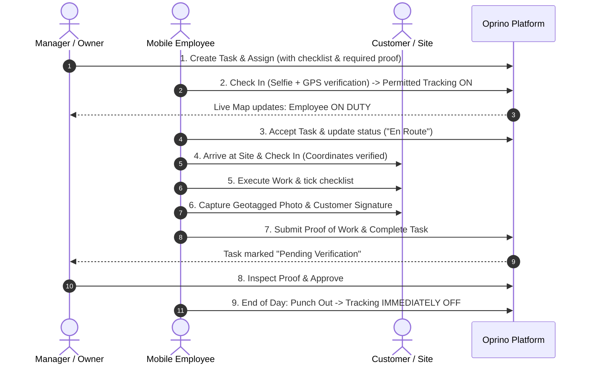

# Oprino Master Product Requirement Document (PRD)

**Document:** Comprehensive Master PRD  
**Version:** 1.0 (APPROVED & FROZEN - Controlling Baseline for Phase 01)  
**Date:** October 2026  
**Status:** APPROVED & FROZEN (Stakeholder Sign-Off Recorded)  

---

## Table of Contents
1. [Product Vision](#1-product-vision)
2. [Product Definition](#2-product-definition)
3. [Problem Statement](#3-problem-statement)
4. [Target Market](#4-target-market)
5. [User Personas](#5-user-personas)
6. [Supported Platforms](#6-supported-platforms)
7. [User Roles & Permissions](#7-user-roles--permissions)
8. [Core Workflows](#8-core-workflows)
9. [Platform Modules](#9-platform-modules)
10. [V1 Scope Summary](#10-v1-scope-summary)
11. [Explicit Non-Goals](#11-explicit-non-goals)
12. [Mobile Application Experience](#12-mobile-application-experience)
13. [Web Dashboard Experience](#13-web-dashboard-experience)
14. [Attendance Policies & Rules](#14-attendance-policies--rules)
15. [Location Tracking & Privacy Rules](#15-location-tracking--privacy-rules)
16. [Domain Data Model: Tasks](#16-domain-data-model-tasks)
17. [Domain Data Model: Visits & Sites](#17-domain-data-model-visits--sites)
18. [Proof of Work (PoW) Engine](#18-proof-of-work-pow-engine)
19. [Reporting & Analytics](#19-reporting--analytics)
20. [Notification Engine](#20-notification-engine)
21. [Offline-First Behavioral Specifications](#21-offline-first-behavioral-specifications)
22. [Security, Tenancy & Privacy Architecture](#22-security-tenancy--privacy-architecture)
23. [Commercial Pricing Direction](#23-commercial-pricing-direction)
24. [Optional & Modular Features](#24-optional--modular-features)
25. [V2 / V3 Evolutionary Roadmap](#25-v2--v3-evolutionary-roadmap)
26. [Competitive Positioning & Differentiation](#26-competitive-positioning--differentiation)
27. [Feature Priority Summary](#27-feature-priority-summary)
28. [Product Risks & Mitigations](#28-product-risks--mitigations)
29. [Open Product Decisions & Phase 01 Spikes](#29-open-product-decisions--phase-01-spikes)
30. [Acceptance Criteria for Planning Completion](#30-acceptance-criteria-for-planning-completion)

---

## 1. Product Vision
To empower small and medium businesses with an effortless, trustworthy operational nervous system that unites distributed work, attendance, and task execution while upholding uncompromising standards for employee privacy and dignity.

---

## 2. Product Definition
**Oprino** is a mobile-first workforce operations platform for SMBs that seamlessly connects task management, attendance, and field-force operations into a single closed-loop workflow:  
**Plan → Assign → Check in → Work → Visit → Verify → Complete → Review**.

---

## 3. Problem Statement
SMBs managing distributed, mobile, and deskless employees suffer from operational fragmentation:
- **WhatsApp Chaos:** Work is dispatched in chat groups, resulting in lost context, untracked progress, and zero verification.
- **Attendance Fraud & Buddy Punching:** Paper timesheets or unverified punch apps lead to time theft and inaccurate payroll inputs.
- **Blind Field Operations:** Business owners do not know where mobile staff are during work hours or if client appointments are being honored on time.
- **Invasive Competitor Surveillance:** Existing field tracking tools practice 24/7 background surveillance, causing employee resentment, high app uninstallation, and battery drain.
- **Unverified Job Completion:** Disputed customer invoices due to lack of tamper-proof proof of work (photos, timestamps, coordinates, signatures).

---

## 4. Target Market

Oprino is a **horizontal, multi-industry Task Management + Workforce Management + Field Operations SaaS platform**, not a vertical-specific field-service product.

- **Target Organization Size:** Approximately **5 to 500 employees**, primarily optimized for **10 to 200 employees**.
- **Potential Industries & Operational Use Cases:**
  - Field service & repair
  - Maintenance & preventive upkeep
  - Installation & commissioning (telecom, solar, HVAC, appliances)
  - Facility management & cleaning operations
  - Field sales & client onboarding
  - Distribution & last-mile delivery
  - Inspection & compliance checks
  - Audits & quality assurance
  - Collections & debt recovery
  - Security operations & patrol logging
  - Merchandising & retail shelf audits
  - Property & real estate site operations
  - Construction support & contractor supervision
  - Multi-location SMB operations (branch & franchise management)
  - Any business managing mobile, deskless, or distributed employees.

---

## 5. User Personas

```
┌─────────────────────────────────┐   ┌─────────────────────────────────┐   ┌─────────────────────────────────┐
│     Suresh Patel (48)           │   │     Anand Verma (34)            │   │     Rajesh Kumar (26)           │
│     The SMB Business Owner      │   │     The Operations Manager      │   │     The Mobile Field Operator   │
├─────────────────────────────────┤   ├─────────────────────────────────┤   ├─────────────────────────────────┤
│ • Wants real-time peace of mind │   │ • Dispatches 30–50 daily tasks  │   │ • Operates on the move          │
│ • Needs reliable attendance     │   │ • Needs live team map           │   │ • Needs simple one-handed app   │
│ • Hates complex enterprise ERPs │   │ • Reviews photos & proof        │   │ • Demands battery & privacy     │
│ • Uses Desktop Web & Mobile App │   │ • Uses Web & Manager Mobile App │   │ • Uses Employee Mobile App      │
└─────────────────────────────────┘   └─────────────────────────────────┘   └─────────────────────────────────┘
```

1. **The Business Owner (Executive Admin):** Seeks overall efficiency, on-time completion rates, accurate attendance records, and verified client deliverables without paying for bloated enterprise software.
2. **The Operations Manager / Supervisor:** Balances daily rosters, reassigns emergency tasks, verifies field photos and customer signatures, and monitors live team movements during duty hours.
3. **The Mobile Operator / Technician:** Values a fast, uncluttered mobile interface that clearly shows what to do next, doesn't drain phone battery, works offline, and guarantees that tracking stops when duty ends.

---

## 6. Supported Platforms

| Surface | Target Persona | Platform Scope | Core Functional Focus |
|---|---|---|---|
| **Employee Mobile App** | Mobile staff, technicians, site agents | Native Android & iOS *(Framework to be selected in Phase 01)* | Offline-first execution, thumb-driven, task updates, GPS/selfie punch, proof capture. |
| **Owner/Manager Mobile App** | Business Owners, Supervisors | Native Android & iOS *(Framework to be selected in Phase 01)* | Real-time duty-hours map, instant approvals, exception alerts, quick dispatch. |
| **Owner/Manager Web Dashboard**| Owners, Dispatchers, HR | Modern Desktop Web *(Framework to be selected in Phase 01)* | High-density tables, full operational map, reporting studio, system settings. |

---

## 7. User Roles & Permissions

### 7.1 Default V1 Roles
- **Owner / Admin:** Complete organizational control, subscription billing, multi-branch setup, global policy enforcement, and full audit logs.
- **Manager:** Operational dispatch, team task assignment, live duty-hours map view for assigned staff, proof-of-work approvals, and leave management.
- **Employee:** Individual task execution, attendance punch, site check-in, proof-of-work submission, personal KPI review.

### 7.2 Extensible Custom Roles (Future Scope)
Architecture must support custom roles (`Supervisor`, `Team Lead`, `Area Manager`, `Regional Manager`, `Dispatcher`) with configurable permissions and tenant-safe access control.  
*(Note: A formal data model such as `Resource:Action:Scope` is a Phase 01 architecture candidate).*

---

## 8. Core Workflows

### 8.1 The Primary Field Loop


---

## 9. Platform Modules

1. **Attendance Engine:** Policy-driven punch in/out with visual (selfie), spatial (GPS/geofence), and hardware timestamp verification.
2. **Duty Tracking Engine:** Background location ingestion active exclusively during authorized duty hours.
3. **Task & Workflow Engine:** Multi-stage lifecycle with checklists, priorities, attachments, comments, and recurrence.
4. **Site & Customer Directory:** Hierarchical directory linking physical customer coordinates to tasks and visits (can be disabled).
5. **Visits Module:** Decoupled site visit logging with duration and check-in/out telemetry.
6. **Proof of Work (PoW) Engine:** Watermarked photos, on-glass signatures, mandatory checklists, and manager approval queues.
7. **Operational Live Map:** Clustered real-time technician markers, status states, and duty-hours breadcrumbs.
8. **Reporting & Analytics Studio:** Exportable audit trails for attendance, SLA compliance, visits, and conveyance.
9. **Offline Synchronization Engine:** Resilient client-side queue ensuring offline-first execution with conflict-aware synchronization.
10. **Administration & Policies:** Multi-tenant workspace switcher, configurable permissions, device policies, and configurable retention.

---

## 10. V1 Scope Summary

- **MUST Items Included:** Simple/GPS/Selfie Attendance, Duty-Hours Live Map & Breadcrumb Trail, 7-Stage Task Workflow, Single/Multiple Assignees, Task Checklists, Attachments, Comments, Watermarked Photo Proof, Customer Signatures, Manager Approvals, Customer/Site Directory, Offline Mobile Execution, Web Dashboard, Bulk CSV Import, Basic PDF/Excel Reports.
- **Fast-Follow (V1.5):** Conveyance per-km calculation, geofenced punch restriction, planned visit ordering, lightweight leave module, stationary exception alerts.
- **Deferred (V2/V3):** Algorithmic beat optimization, dynamic custom form builder, WhatsApp Business integration, AI visual proof checking, AI dispatch copilot, enterprise SSO.

---

## 11. Explicit Non-Goals
Oprino is strictly focused on workforce operations execution. It explicitly will **NOT** build:
- Sales Pipeline CRM / Lead Scoring
- Double-Entry Accounting / Ledger / Invoicing
- Full Statutory Payroll Calculation (PF, ESI, Tax Filing)
- Warehouse Bin & SKU Inventory Management
- Full HRMS / Appraisal Systems
- Heavy Project Management (Gantt charts, Agile sprint boards)

---

## 12. Mobile Application Experience

### 12.1 Visual Design & Ergonomics
- Built using **Manrope** typography, **Cobalt (`#164CFF`)** touch targets, and **Paper (`#F8FAFC`)** backgrounds.
- High-contrast, minimum 48x48 px touch targets designed for mobile operations.
- Dark mode support utilizing authoritative **Navy (`#0F172A`)** surfaces.

### 12.2 Duty Tracking State Visibility (Approved Requirement)
- **Approved Requirement:** Employees must always clearly know whether tracking is **ON** or **OFF**, when tracking started, when tracking stopped, and the applicable company policy.
- **UX Candidate for Design Phase:** A persistent top-bar status banner:
  - `Duty ON`: Mint pill: `🟢 Duty ON • Tracking Active (Started HH:MM AM)`.
  - `Duty OFF`: Slate pill: `⚪ Off Duty • Location Tracking Inactive`.
  - Tapping opens the Attendance Action Sheet.

---

## 13. Web Dashboard Experience
- High-density information architecture designed for desktop displays.
- **Space Grotesk** for metric cards and page headings; **Manrope** for data grids.
- Split-screen live map with real-time technician status cards.
- Quick Universal Search (`⌘K` / `Ctrl+K`) for rapid navigation across technicians, tasks, and client sites.
- Multi-company / workspace dropdown switcher in the header.

---

## 14. Attendance Policies & Rules

Organizations configure their attendance requirements per branch or team:
1. **Simple Punch:** Timestamp + device status only.
2. **GPS-Verified Punch:** Requires active device GPS fix with acceptable horizontal accuracy.
3. **Selfie-Verified Punch:** Mandatory front-facing camera photo; prevents buddy punching.
4. **Geofenced Punch (V1.5):** Punch-in permitted only if device is within authorized boundary of office or assigned site.
5. **Regularization Workflow:** If an employee forgets to punch out, they submit an attendance regularization request with manager approval required.

---

## 15. Location Tracking & Privacy Rules

### 15.1 The Inviolable Duty Boundary (Locked Product Decision)
```
[PUNCH IN EVENT]  ──>  Permitted Location Tracking ACTIVATES
                       • Periodic coordinate pings during duty hours
                       • Significant motion updates
                       • Battery-conscious stationary sleep
[PUNCH OUT EVENT] ──>  Location Tracking HARD STOP
                       • Continuous tracking stops immediately
                       • Background location listeners terminated
                       • Zero coordinates ingested or stored while off duty
```

### 15.2 Tracking Modes
- **Mode A (Current Location Only):** System stores only the single most recent coordinate ping; no breadcrumbs saved.
- **Mode B (Full Duty-Hours Route History):** Breadcrumbs captured during duty hours to recreate route trails and compute travel conveyance.
- **Mode C (Site Visits Only):** Location captured only at the moment of site check-in and check-out.

### 15.3 Retention Policies (Stakeholder Approved)
- **Approved Default Retention:** **30 days** of location-history retention.
- **Supported Policy Options:** **7 days**, **30 days**, **90 days**, **180 days**, and **extended/custom retention** where supported by plan tier or compliance requirements.
- **Regulatory Exception:** Legal or regulatory compliance requirements may override the product default where necessary.

### 15.4 Peer Location Access (Stakeholder Approved)
- **Approved Default Policy:** Employee-to-employee live location visibility is **OFF**.
- **Authorized Access Only:** Duty-hours employee location may be accessed only by authorized roles:
  - `Owner/Admin`
  - `Manager`
  - Other explicitly permitted custom roles
- **Future Governance:** Any future peer/team location-sharing capability must require an explicit company policy and permission.

---

## 16. Domain Data Model: Tasks

- **Core Attributes:** ID, Workspace ID, Title, Description, Priority, Status, Due Date, Customer ID, Site ID, Assignee IDs, Checklist Items, Attachments, Proof Policy, Timestamps.
- **Default Lifecycle:** `ASSIGNED` → `ACCEPTED` → `EN_ROUTE` → `ARRIVED` → `IN_PROGRESS` → `COMPLETED` → `VERIFIED`.
- **Assignment Types:** Single employee, multiple employees, or unassigned pool.
- **Recurrence:** Daily, weekly, monthly templates automatically generating tasks at scheduled hours.
*(Note: Concrete database table schemas and indexing belong to Phase 01 architecture).*

---

## 17. Domain Data Model: Visits & Sites

- **Customer:** Account / client entity (e.g., *"Apex Facilities"*).
- **Site:** Physical location belonging to a customer, defined by street address, coordinates, and geofence boundary.
- **Visit:** Physical stop made by an employee. Contains check-in timestamp/coordinates, check-out timestamp/coordinates, duration, and on-site notes.
- **Relation:** Tasks and visits are separate concepts. A single Task can link 0, 1, or multiple physical Visits.

---

## 18. Proof of Work (PoW) Engine

Proof of work ensures tamper-resistant verification of completed tasks:
1. **Watermarked Photo Capture:** Camera stamps image with timestamp, coordinates, reverse-geocoded reference, and task ID.
2. **On-Glass Customer Signature:** Signature canvas capturing client sign-off with signer name, phone, and confirmation.
3. **Mandatory Checklist Validation:** Prevents transition to `COMPLETED` until 100% of required checklist items are checked.
4. **Manager Verification Queue:** Tasks marked `COMPLETED` enter `PENDING_VERIFICATION` state until reviewed by a supervisor.

---

## 19. Reporting & Analytics

- **Daily Attendance Sheet:** Present, absent, late arrival minutes, total duty hours (CSV/Excel/PDF).
- **Task SLA & Completion Report:** Percentage on-time vs overdue, rejected proof count.
- **Customer Visit Audit:** Log of all site check-ins, time on site, and coordinate compliance.
- **Conveyance & Distance Log (V1.5):** Total duty-hours kilometers per worker for travel reimbursement.

---

## 20. Notification Engine

- **Channels (V1):** Mobile Push, In-App notification center, Transactional Email digests.
- **Key Triggers:**
  - Task assigned or reassigned
  - Task approaching due date / Overdue
  - Proof of work rejected with manager reason
  - Attendance punch reminder (start of shift)
  - Critical operational broadcast from management

---

## 21. Offline-First Behavioral Specifications

Field and site staff frequently operate in low-connectivity environments:
- **Approved Requirement:** The employee mobile app must support offline-first execution of approved core workflows (viewing assigned tasks, status changes, checklist updates, photo proof, signatures, and attendance events), with reliable conflict-aware synchronization after connectivity returns.
- **Conflict Resolution:** Local operational event timestamps govern execution time. Sync operations must be idempotent to prevent duplicate submissions. *(Technology selection belongs to Phase 01).*

---

## 22. Security, Tenancy & Privacy Architecture

- **Multi-Tenancy:** Horizontal tenant isolation where every database query requires workspace/company scoping.
- **Role-Based Access Control:** Strict enforcement on all API routes and UI views.
- **Inviolable Duty Boundary:** Off-duty location tracking must NEVER occur. Location payloads outside active duty are dropped.
- **Audit Logging:** Immutably records admin overrides, attendance edits, and policy changes.
- **Data Encryption:** Industry-standard encryption in transit and at rest for sensitive data and uploaded assets.

---

## 23. Commercial Pricing Direction

- **Hybrid Model:** Base subscription per seat/user + modular add-ons.
- **Tiers:**
  - **Starter (5–15 users):** Simple attendance, core tasks, photo proof, mobile app.
  - **Growth (15–50 users):** Selfie/GPS attendance, live map, route trails, manager app, recurring work.
  - **Business (50–200 users):** Geofences, exception engine, multi-branch, leave management, extended retention.
  - **Enterprise (200–500+ users):** Custom roles, SLA guarantees, API access, dedicated manager.
- **Self-Serve Trial:** 14-day free trial on Growth tier.

---

## 24. Optional & Modular Features

- **Customer/Site Management:** Can be completely disabled by SMBs that manage internal operations only.
- **Conveyance & Expense Tracking (Add-on):** Automated fuel reimbursement calculation based on GPS distance.
- **Route / Beat Planning (Add-on):** Multi-stop route sequencing and travel optimization.
- **WhatsApp Alerts (Add-on):** WhatsApp Business notifications for workers and managers.

---

## 25. V2 / V3 Evolutionary Roadmap
- **V1.5:** Expense conveyance, geofenced punch, visit sequencing, leave management, stationary alerts.
- **V2.0:** Algorithmic beat planning, dynamic inspection form builder, WhatsApp alerts, custom roles, SOS button, public API.
- **V3.0:** Computer vision photo proof verification, AI dispatch copilot, predictive SLA warnings, accounting/ERP connectors (Tally, Zoho, QuickBooks), Enterprise SSO.

---

## 26. Competitive Positioning & Differentiation

| Dimension | TaskOPad | Unolo | Oprino Advantage |
|---|---|---|---|
| **Task Management** | Strong | Weak / Rudimentary | **High Quality** (7-stage workflow, checklists, recurrence) |
| **Field Tracking** | Weak / None | Strong | **Duty-Hours Only** (Privacy-first, live map, breadcrumbs) |
| **Privacy Guarantee** | N/A | Invasive (24/7 pushback) | **Strict Off-Duty Cutoff** (Zero off-duty tracking) |
| **SMB Simplicity** | Complex Desktop | Enterprise Clutter | **Fast Onboarding** (< 5 mins via CSV) |
| **Target Breadth** | Task Focus | Sales/Field Focus | **Horizontal Multi-Industry SMB** |

---

## 27. Feature Priority Summary

- **P0 (Absolute V1 Launch Blockers):** Mobile Apps (iOS/Android), Web Dashboard, Simple/GPS/Selfie Attendance, Clear Tracking State Visibility, Live Map, 7-Stage Tasks, Checklists, Watermarked Photo Proof, On-Glass Signature, Offline-First Mobile Execution, CSV Bulk Import.
- **P1 (High Priority Polish / V1.5):** Conveyance per-km calculation, geofenced attendance, visit sequencing, leave management, stationary alerts.
- **P2 (Strategic Expansion / V2):** Route optimization, dynamic form builder, WhatsApp alerts, custom RBAC, SOS button.
- **P3 (Future Horizon / V3):** AI computer vision, AI natural language copilot, Enterprise SSO.

---

## 28. Product Risks & Mitigations

1. **Risk: Mobile OS Kills Background Tracking:**  
   *Mitigation:* Implement standard mobile OS background/foreground execution policies during Phase 01.
2. **Risk: Employee Location Spoofing / Mock Apps:**  
   *Mitigation:* Detect mock-location flags; record anomalies in the audit log without crashing the application.
3. **Risk: Cellular Data Consumption from Photos:**  
   *Mitigation:* Compress photos on device before queueing while preserving watermark clarity.
4. **Risk: Offline Sync Collisions:**  
   *Mitigation:* Append-only event queue with deterministic idempotent server transaction processing.

---

## 29. Final Product Policy Decisions & Phase 01 Spikes

### 29.1 Product Policy Decisions (Frozen by Stakeholder Sign-Off)
1. **Default Location Retention Duration:** Frozen at **30 days** (supported options: 7, 30, 90, 180 days, extended/custom).
2. **Peer Location Visibility Policy:** Frozen at **OFF by default**; accessible only by authorized roles (Owner, Manager, permitted custom roles).
3. **Geofence Policy Thresholds:** Configurable per site/branch (default evaluation baseline: 100m).

### 29.2 Phase 01 Technical Spikes (Implementation Architecture Authorized)
1. **Mobile Framework Spike:** Evaluate Flutter vs React Native for cross-platform background geolocation stability and offline data store performance.
2. **Web Framework & State Spike:** Evaluate web framework setup for high-density desktop dashboards.
3. **Mapping Provider Spike:** Benchmark map tile providers for tile costs vs vector rendering smoothness.
4. **Real-Time Map Transport Spike:** Evaluate WebSockets vs Server-Sent Events (SSE) vs pub/sub for duty-hours coordinate streaming.
5. **Backend, Database & Tenancy Architecture:** Select server runtime, database, and multi-tenant schema partitioning strategy.

---

## 30. Acceptance Criteria for Planning Completion

- [x] Complete project file and brand asset audit documented and verified.
- [x] Authoritative brand design system extracted, documented, and verified.
- [x] Core product principles, multi-industry definition, and non-goals documented and approved.
- [x] Three-tier default roles and custom role requirements approved.
- [x] Non-negotiable duty-hours tracking privacy cutoff approved and frozen.
- [x] V1 feature boundaries classified across MUST, SHOULD, LATER, and OUT OF SCOPE.
- [x] Application surface information architecture specified for all 3 surfaces.
- [x] Competitive parity and differentiation against TaskOPad and Unolo approved.
- [x] Hybrid pricing, packaging tiers, and add-on roadmap approved.
- [x] Final product policy decisions (30-day retention, peer visibility OFF) incorporated.
- [x] Master PRD consolidated and frozen as controlling baseline for Phase 01.

```text
====================================================================================================
Stakeholder Product Plan Approval: APPROVED
Phase 00 Status:                   FROZEN
Phase 01 Technical Architecture:   AUTHORIZED TO BEGIN
====================================================================================================
```
