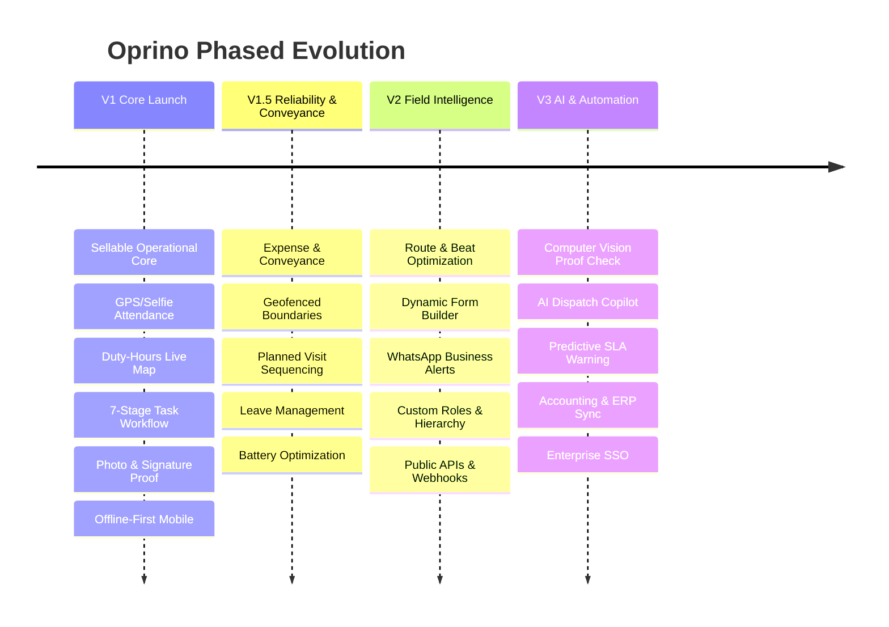

# Oprino Multi-Phase Product Roadmap

**Document:** Product Engineering & Release Roadmap  
**Phase:** 00 — Pre-Development Freeze (Final Reconciliation)  
**Status:** Documented & Verified Against Current Product Plan (Subject to Stakeholder Approval)  
**Strategic Principle:** Fast path to revenue with a rock-solid V1 operational core. AI and complex automations are strictly decoupled from V1. Technical framework selections belong to Phase 01.

---

## 1. Roadmap Architecture Overview

---

## 2. Phase V1: The Sellable Operational Core

**Goal:** Deliver a commercially viable, reliable SaaS platform that multi-industry SMB owners can immediately buy to eliminate operational chaos.

### Core Capabilities Delivered:
1. **Attendance Engine:**
   - Simple, GPS-verified, and selfie-verified punch in/out.
   - Clear tracking state visibility (`Tracking ON` / `Tracking OFF`), when tracking started/stopped, and applicable company policy. *(Persistent status banner is a UX candidate).*
   - Inviolable duty boundary: off-duty location tracking must NEVER occur. Tracking activates on punch-in and terminates immediately upon punch-out.
2. **Duty-Hours Location & Operational Map:**
   - Real-time location markers on Web Dashboard and Manager Mobile App.
   - Historical breadcrumb trail playback for duty hours.
   - Configurable location retention (7, 30, 90, 180 days, custom/extended). *(Default retention duration is a product configuration decision pending packaging/legal review).*
3. **Structured Task Management:**
   - Default field workflow (`Assigned` → `Accepted` → `En Route` → `Arrived` → `In Progress` → `Completed` → `Verified`).
   - Task checklists, priorities, attachments, comments, and single/multiple assignees.
   - Daily and weekly recurring task automation.
4. **Site Visits & Proof of Work:**
   - Separation of tasks and physical customer visits.
   - Customer & Site Directory (with toggle to disable if not needed).
   - Watermarked geotagged photo capture, customer on-glass signature, mandatory checklists.
   - Manager verification inbox (Approve / Reject).
5. **Mobile & Offline-First Core:**
   - Native Employee Mobile App (iOS / Android) supporting offline-first execution of approved core workflows, with reliable conflict-aware synchronization after connectivity returns.
   - Native Manager Mobile App (iOS / Android) for field approvals.
6. **Data & Multi-Tenancy:**
   - Strict horizontal tenant isolation across all layers.
   - Default 3 roles: Owner/Admin, Manager, Employee, with configurable permissions.
   - Bulk CSV import for employees and customer sites; essential PDF/Excel export reports.

---

## 3. Phase V1.5: Reliability, Conveyance & Workflow Refinements

**Goal:** Deepen operational utility, reduce manager friction, and automate travel expense accounting.

### Key Capabilities Delivered:
1. **Conveyance & Travel Reimbursement:**
   - GPS-derived travel distance calculation during active duty hours.
   - Vehicle classification (Two-wheeler, Four-wheeler) with company per-km rates.
   - Basic receipt photo upload and manager reimbursement approval.
2. **Geofenced Operations:**
   - Geofence-restricted attendance (force punch-in within office or assigned site boundary).
   - Site check-in geofence proximity validation.
3. **Planned Visit Sequencing:**
   - Ordered daily visit itinerary (Stop 1 → Stop 2 → Stop 3) on employee mobile app.
4. **Lightweight Leave Management:**
   - Leave types (Casual, Sick, Annual), balance tracking, employee application, and manager approval.
5. **Operational Exception Engine:**
   - Configurable alerts for late arrivals, missing location updates, and stationary idle stops.
6. **Device Integrity & Battery Optimization:**
   - Mock-location heuristic flags in audit logs.
   - Adaptive sensor polling intervals to maximize device battery life during duty hours.

---

## 4. Phase V2: Field Intelligence & Advanced Operations

**Goal:** Expand into mid-sized fleets, complex multi-branch hierarchies, and third-party communications.

### Key Capabilities Delivered:
1. **Route & Beat Optimization:**
   - Multi-stop route calculation optimizing travel time and fuel cost.
   - Beat scheduling for sales representatives and recurring field technicians.
2. **Dynamic Forms & Inspection Builder:**
   - Form builder (text, dropdowns, numbers, condition logic, audit checklists).
   - Export custom branded PDF inspection and service certificates.
3. **WhatsApp Business & SMS Messaging:**
   - Automated dispatch notifications sent directly via WhatsApp to workers and clients.
   - SMS backup for low-data field environments.
4. **Organizational Hierarchy & Custom Roles:**
   - Multi-tier structure: Company → Region → Branch → Department → Team.
   - Role builder for Supervisors, Area Managers, and Dispatchers with custom permission toggles.
5. **Worker Safety & SOS:**
   - In-app emergency SOS panic button broadcasting live coordinates to dispatchers and managers.
6. **Extensibility & Integrations:**
   - Developer REST API and webhooks for data extraction and external event triggers.

---

## 5. Phase V3: AI, Automation & Ecosystem Expansion

**Goal:** Introduce predictive intelligence, enterprise compliance, and automated operational copilots.

> [!NOTE]
> **AI Isolation:** Phase V3 capabilities rely on AI and computer vision models. These are strictly excluded from V1 to prevent premature complexity, high inference costs, and launch delays.

### Key Capabilities Delivered:
1. **AI Visual Proof Verification:**
   - Computer vision models analyzing uploaded photo proofs (e.g., verifying work completion, safety gear, or meter readings).
2. **AI Dispatch & Operations Copilot:**
   - Natural language interface for managers (*"Show me technicians within 5 km of Client X who are free after 2 PM"*).
   - Automated smart task assignment based on location, skill match, and current workload.
3. **Predictive SLA Risk Engine:**
   - Machine learning models forecasting delayed visits based on real-time traffic and past technician speed.
4. **Enterprise Accounting & ERP Connectors:**
   - Pre-built direct sync connectors for QuickBooks, Zoho Books, Tally, and major payroll engines.
5. **Enterprise Security Suite:**
   - Single Sign-On (SSO) via SAML 2.0, Okta, Microsoft Azure AD, and custom enterprise data residency.
