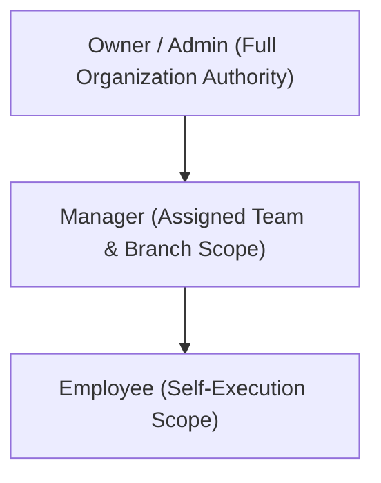

# Roles and Permissions Plan

**Document:** Roles & Permissions Plan  
**Phase:** 00 — Pre-Development Freeze  
**Status:** APPROVED & FROZEN (Stakeholder Sign-Off Recorded)  
**Notice:** Planning and functional requirements only. No RBAC code or technical schema is to be implemented during Phase 00.

---

## 1. Overview & Strategy

Oprino serves SMBs ranging from approximately 5 to 500 employees (primarily optimized for 10 to 200 employees) across diverse mobile and distributed industries. To balance simplicity for 10-person businesses with governance for 200-person multi-branch enterprises, Oprino adopts a **tiered role model**:
1. **V1 Out-of-the-Box Core Roles:** Three clear, robust defaults (`Owner/Admin`, `Manager`, `Employee`) requiring zero configuration.
2. **Extensible Role Architecture:** Support for custom organizational roles (`Supervisor`, `Team Lead`, `Area Manager`, `Regional Manager`, `Dispatcher`) with configurable permissions and tenant-safe access control.

---

## 2. Default Core Roles (V1)

### 2.1 Owner / Admin
- **Description:** Business owner, managing director, or executive operations administrator.
- **Scope:** Entire company account / workspace.
- **Key Capabilities:**
  - Full company configuration (branding, attendance rules, tracking policies, business hours).
  - Billing, plan selection, invoice downloads, and subscription management.
  - Add, invite, edit, assign, or deactivate any employee or manager.
  - Create and configure branches, departments, and teams.
  - Full visibility into all operational maps, live tracking (duty hours only), tasks, visits, and reports.
  - Final approval on high-level exceptions, leave, and attendance regularizations.

### 2.2 Manager
- **Description:** Branch manager, operational supervisor, department head, or field coordinator.
- **Scope:** Assigned branches, departments, teams, or direct reports.
- **Key Capabilities:**
  - Create, assign, prioritize, schedule, and reassign tasks to assigned employees.
  - View live operational map and route trails for assigned duty-active employees only.
  - Review and approve proof of work, completed visits, and task submissions.
  - Approve or reject attendance regularizations, expense claims (future), and leave requests.
  - Generate and export operational reports for assigned teams.
  - *Restricted:* Cannot alter company billing, change global security policies, or access teams outside their assigned branch hierarchy.

### 2.3 Employee
- **Description:** Field technician, mobile agent, site coordinator, sales rep, delivery operator, or in-office worker.
- **Scope:** Self only (and collaborative tasks where explicitly assigned).
- **Key Capabilities:**
  - Punch in and punch out for duty (validating company policy: simple, GPS, selfie, or geofence).
  - View personal daily agenda, assigned tasks, checklists, and visit itineraries.
  - Update task lifecycle states (`Assigned`, `Accepted`, `En Route`, `Arrived`, `In Progress`, `Completed`).
  - Check in to customer/site locations and record verified visits.
  - Upload proof of work (photos, notes, customer signatures, completed forms).
  - Clearly see tracking state at all times (`Tracking ON` / `Tracking OFF`), when tracking started, when tracking stopped, and the applicable company policy.
  - View personal attendance history, task completion stats, and performance score.
  - *Restricted:* Cannot edit verified timestamps or override company policies.

---

## 3. Extensible Custom Roles (Future Scope)

For mid-market SMBs (50–200+ employees), operational hierarchies require granular authority between standard Managers and Employees:

| Custom Role | Organizational Level | Recommended Scope & Authority |
|---|---|---|
| **Regional Manager** | Multi-Branch / Territory | Oversees multiple branches within a geographic region; views aggregated territory metrics. |
| **Area Manager** | Cluster / City | Manages 2–5 local branches; handles cross-branch resource allocation. |
| **Supervisor** | Frontline Field Pod | Direct oversight of 5–15 field agents; conducts real-time dispatch and on-the-spot verification. |
| **Team Lead** | Department / Skill Group | Manages task assignments, peer reviews, and technical checklists without HR/leave authority. |
| **Dispatcher / Viewer**| Back-office Support | Read-only operational map monitoring and call-in task creation; no approval or HR rights. |

---

## 4. Permissions Planning (Functional Matrix)

> [!NOTE]
> **Product Requirement vs Technical Candidate:**  
> The approved product requirement is **configurable permissions and tenant-safe access control** across default and custom roles.  
> Modeling this via a specific `"Resource:Action:Scope"` structure is a **Phase 01 architecture candidate**, to be formally designed and evaluated alongside database and API architecture.

### Functional Capability Distribution

| Functional Area | Owner / Admin | Manager | Employee | Custom Role Target |
|---|:---:|:---:|:---:|:---:|
| **Attendance Punch In/Out (Self)** | ✅ | ✅ | ✅ | Standard |
| **View Self Attendance History** | ✅ | ✅ | ✅ | Standard |
| **View Team Attendance Logs** | ✅ | ✅ (Assigned) | ❌ | Supervisor / Lead |
| **View Organization Attendance** | ✅ | ❌ | ❌ | Regional / Area |
| **Approve Attendance Regularization** | ✅ | ✅ (Assigned) | ❌ | Supervisor |
| **View Live Map (Duty Hours Only)** | ✅ (All) | ✅ (Assigned) | ❌ (Default) | Dispatcher / Lead |
| **View Route History (Duty Hours Only)**| ✅ (All) | ✅ (Assigned) | ❌ | Area Manager |
| **Configure Company Tracking Policy** | ✅ | ❌ | ❌ | Restricted |
| **Create & Assign Tasks** | ✅ | ✅ | ❌ (V1) | Lead / Supervisor |
| **Update Task Lifecycle (Self)** | ✅ | ✅ | ✅ | Standard |
| **Approve Task Proof of Work** | ✅ | ✅ (Assigned) | ❌ | Supervisor / Lead |
| **Log Site Visit** | ✅ | ✅ | ✅ | Standard |
| **Verify Site Visit** | ✅ | ✅ (Assigned) | ❌ | Supervisor |
| **Manage Customer / Site Directory** | ✅ | ✅ (Optional)| ❌ | Dispatcher |
| **Apply for Leave** | ✅ | ✅ | ✅ | Standard |
| **Approve Team Leave** | ✅ | ✅ (Assigned) | ❌ | Area Manager |
| **View Operational Reports** | ✅ | ✅ (Assigned) | ❌ (Own only)| Lead / Supervisor |
| **Export Data (CSV / PDF)** | ✅ | ✅ (Assigned) | ❌ | Restricted |
| **Manage Billing & Subscriptions** | ✅ | ❌ | ❌ | Restricted |
| **Manage User Invitations & Roles** | ✅ | ❌ | ❌ | Restricted |

---

## 5. Security & Privacy Guardrails

1. **Horizontal Tenant Isolation:** Multi-tenancy must strictly isolate all data by workspace/company. A user in Company A cannot access data in Company B.
2. **Vertical Scoping (Hierarchical Scoping):** Managers are scoped to assigned branches and teams.
3. **Inviolable Duty Boundary:** Off-duty employee location tracking must **NEVER** occur. When an employee is off-duty, location coordinates must never be ingested, stored, or queried by any role (including Owner).
4. **Peer Location Visibility (Stakeholder Approved):** Employee-to-employee live location visibility is **OFF** by default. Duty-hours employee location may be accessed only by authorized roles (`Owner/Admin`, `Manager`, and explicitly permitted custom roles). Any future peer/team location-sharing capability requires an explicit company policy and permission.
