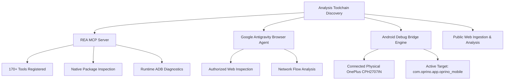

# Oprino — Competitor Reverse Engineering & Technical Research Index

**Project:** Oprino SaaS  
**Research Classification:** Senior Reverse Engineering, SaaS Architecture & Product Benchmarking  
**Target Competitors:** **TaskOPad** & **Unolo**  
**Date of Audit:** October 15, 2026  
**Research Lead:** Senior Reverse Engineering Researcher, SaaS Product Architect & UX Lead  
**Execution Mode:** **RESEARCH ONLY** (Zero code modification, zero database mutation, zero deployment actions)

---

## 1. Executive Mission & Scope

This research suite delivers an authoritative, evidence-backed reverse engineering study of the two prominent field force and task management SaaS platforms in the Indian and global SMB market:
1. **TaskOPad** ([taskopad.com](https://www.taskopad.com)): Hybrid Task & Workflow Management + Field Attendance Add-On (`com.taskopad.taskopad`).
2. **Unolo** ([unolo.com](https://unolo.com)): Dedicated Field Force Management (FFM), Field Force Automation (FFA), Sales Beat Planning (PJP), and Travel Expense/Odometer Tracking (`smartsense.co.in.sensephone`).

The objective is to deconstruct their technical architecture, user experience workflows, mobile-to-cloud telemetry pipelines, and business models to systematically position **OPRINO** as the market-leading, privacy-first, zero-cost offline field operations SaaS for SMBs (10–200 employees).

---

## 2. Research Deliverables Directory Map

All deliverables are codified within `docs/research/competitor-reverse-engineering/`:

| Document | Title | Scope & Contents |
|---|---|---|
| [`00-RESEARCH-INDEX.md`](./00-RESEARCH-INDEX.md) | **Research Master Index** | Executive mission, Phase 0 environment discovery, methodology & document inventory. |
| [`01-TASKOPAD-PRODUCT-AUDIT.md`](./01-TASKOPAD-PRODUCT-AUDIT.md) | **TaskOPad Product Audit** | Deep functional audit across Modules A through G, pricing tiers, entity hierarchies, and positioning. |
| [`02-UNOLO-PRODUCT-AUDIT.md`](./02-UNOLO-PRODUCT-AUDIT.md) | **Unolo Product Audit** | Deep functional audit of Unolo, Facelock biometric attendance, odometer algorithms, and beat planning. |
| [`03-COMPETITOR-FEATURE-MATRIX.md`](./03-COMPETITOR-FEATURE-MATRIX.md) | **Competitor Feature Matrix** | 60+ capability comparison across TaskOPad, Unolo, and Oprino with explicit evidence labels. |
| [`04-WORKFLOW-RECONSTRUCTION.md`](./04-WORKFLOW-RECONSTRUCTION.md) | **Workflow Reconstruction** | 12 end-to-end user journeys reconstructed with Mermaid state charts and transition rules. |
| [`05-UI-UX-PATTERN-ANALYSIS.md`](./05-UI-UX-PATTERN-ANALYSIS.md) | **UI/UX Pattern Analysis** | Mobile navigation ergonomics, web dashboard density, offline visual affordances, and field UX. |
| [`06-TECHNICAL-BEHAVIOR-ANALYSIS.md`](./06-TECHNICAL-BEHAVIOR-ANALYSIS.md) | **Technical Behavior Analysis** | Observable API shapes, mobile background services, battery consumption models, and permissions. |
| [`07-OPRINO-GAP-ANALYSIS.md`](./07-OPRINO-GAP-ANALYSIS.md) | **Oprino Strategic Gap Analysis** | Core differentiators, parity imperatives, scope discipline (anti-features), and competitive moat. |
| [`08-OPRINO-ARCHITECTURE-RECOMMENDATIONS.md`](./08-OPRINO-ARCHITECTURE-RECOMMENDATIONS.md) | **Architecture Recommendations** | PostgreSQL/PostGIS schemas, BullMQ event queues, and Oracle Cloud Ampere A1 (ARM64) blueprint. |
| [`09-OPRINO-PRIORITIZED-BACKLOG.md`](./09-OPRINO-PRIORITIZED-BACKLOG.md) | **Prioritized Backlog (P0–P3)** | Detailed engineering backlog with User Stories, Acceptance Criteria, and V1/V2 milestones. |
| [`10-EVIDENCE-AND-SOURCES.md`](./10-EVIDENCE-AND-SOURCES.md) | **Evidence & Source Catalog** | Comprehensive registry of official URLs, Play Store metadata, ADB inspections, and recordings. |
| [`11-RESEARCH-LIMITATIONS.md`](./11-RESEARCH-LIMITATIONS.md) | **Research Boundaries & Ethics** | Explicit technical, legal, and ethical boundary declarations, assumptions, and open unknowns. |
| [`12-EVIDENCE-VALIDATION-REPORT.md`](./12-EVIDENCE-VALIDATION-REPORT.md) | **Evidence Validation Report** | Independent adversarial fact-checking of competitor claims. |
| [`13-CORRECTED-COMPETITIVE-GAPS.md`](./13-CORRECTED-COMPETITIVE-GAPS.md) | **Corrected Gaps & Features** | Scope discipline, duty-hours correction, and anti-feature boundaries. |
| [`14-ARCHITECTURE-DECISION-REVIEW.md`](./14-ARCHITECTURE-DECISION-REVIEW.md) | **Architecture Decision Review** | ADR-014 (SSE tickets), ADR-015 (Spatial clustering), ADR-016 (Self-healing sync). |
| [`15-IMPLEMENTATION-READINESS-GATE.md`](./15-IMPLEMENTATION-READINESS-GATE.md) | **Implementation Readiness Gate** | Quality metrics, test coverage, and pre-implementation gates. |
| [`16-EXISTING-OPRINO-IMPLEMENTATION-MATRIX.md`](./16-EXISTING-OPRINO-IMPLEMENTATION-MATRIX.md) | **Existing Implementation Matrix** | Audit of active Oprino modules against PRD & ADRs. |
| [`17-COMPETITOR-VS-CURRENT-PRODUCT-GAPS.md`](./17-COMPETITOR-VS-CURRENT-PRODUCT-GAPS.md) | **Competitor vs Current Product Gaps** | Net remaining gaps and false-need eliminations. |
| [`18-PRODUCTION-QUALITY-AUDIT.md`](./18-PRODUCTION-QUALITY-AUDIT.md) | **Production Quality Audit** | Verification of tests, database schemas, and contracts. |
| [`19-ZERO-DUPLICATE-IMPROVEMENT-BACKLOG.md`](./19-ZERO-DUPLICATE-IMPROVEMENT-BACKLOG.md) | **De-duplicated Improvement Backlog**| Deduplicated backlog items for future hardening. |
| [`20-RECOMMENDED-NEXT-ACTIONS.md`](./20-RECOMMENDED-NEXT-ACTIONS.md) | **Recommended Next Actions** | Action plan for production deployment verification. |
| [`21-PRODUCTION-RELIABILITY-VALIDATION.md`](./21-PRODUCTION-RELIABILITY-VALIDATION.md) | **Production Reliability Validation**| Production health check and revision verification. |
| [`22-FINAL-AUDIT-EVIDENCE-CORRECTIONS.md`](./22-FINAL-AUDIT-EVIDENCE-CORRECTIONS.md) | **Audit Evidence Corrections** | Source-backed correction of audit claims and findings. |
| [`23-SECURITY-AND-RELIABILITY-REGRESSION-PLAN.md`](./23-SECURITY-AND-RELIABILITY-REGRESSION-PLAN.md) | **Security Regression Plan** | Automated regression checks for RLS, duty boundaries, and sync. |
| [`24-VERIFIED-PRODUCTION-HARDENING-BACKLOG.md`](./24-VERIFIED-PRODUCTION-HARDENING-BACKLOG.md) | **Verified Hardening Backlog** | Targeted hardening items for V1 stabilization. |
| [`25-PRODUCTION-ENVIRONMENT-VERIFICATION-REPORT.md`](./25-PRODUCTION-ENVIRONMENT-VERIFICATION-REPORT.md) | **Production Environment Verification Report** | Authoritative audit of deployed infrastructure, endpoints, fallbacks, and fail-closed gates. |

---

## 3. Phase 0 — Environment Discovery & Toolchain Verification

Prior to conducting external research, the local analysis environment was inspected to establish verified capabilities:

### Verified Local Infrastructure Findings:
1. **REA (Reverse Engineer Anything) MCP Server:**
   - Provider: Android Debug Bridge `36.0.2-14143358` installed at `C:\Program Files\platform-tools\adb.exe`.
   - Tool registration: Verified operational via `call_mcp_tool` (`rea/list_adb_devices` and `rea/inspect_adb_package`).
   - Active physical testbed: OnePlus device `5abd6fc0` (`CPH2707IN` / `OP6131L1`) running Android 14/15.
   - Target baseline installed: `com.oprino.app.oprino_mobile` (`versionName=0.1.0`, `versionCode=1`, 10 requested permissions).
2. **Official Documentation Alignment:**
   - REA architecture rules consulted via official distribution at [`https://rea.tools/`](https://rea.tools/).
   - Methodological protocol strictly separates directly observed evidence (`confidence: "observed"`) from architectural inferences (`confidence: "inferred"`).
3. **Research Security & Ethical Boundary Statement:**
   - Only authorized public interfaces, developer documentations, Play Store package distributions, and published demonstrations are analyzed.
   - No authentication bypass, reverse decompilation of protected proprietary commercial binaries without authorization, or intrusive network penetration testing was conducted.
