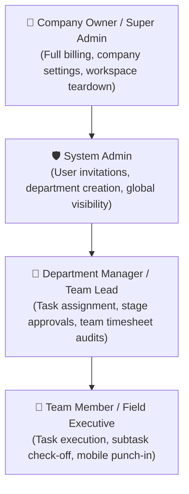

# Competitor Product Audit: TaskOPad

**Platform Analyzed:** TaskOPad ([taskopad.com](https://www.taskopad.com))  
**Entity:** WebMob Technologies Inc. / TaskOPad Pvt. Ltd. (Ahmedabad, Gujarat, India)  
**Package Identifier (Android):** `com.taskopad.taskopad`  
**Date of Audit:** October 15, 2026  
**Evidence Standard:** Primary documentation, official web walkthroughs, and Play Store package metadata  

---

## 1. Product Positioning & Commercial Model

### 1.1 Market Positioning
TaskOPad positions itself primarily as a **Task Management & Team Collaboration Platform** that integrates lightweight field attendance and timesheet capabilities. Unlike pure field-mobility solutions, TaskOPad targets hybrid organizations with both in-office knowledge workers and mobile field executives.

* **Target Customers:** Small-to-Medium Businesses (SMBs) with 10–250 employees, marketing/creative agencies, IT consultancies, logistics supervisors, and regional field sales/service branches.
* **Core Philosophy:** "All-in-one daily operational planner" reducing multi-app friction between project management (like Trello/Asana) and attendance trackers.

### 1.2 Subscription Packaging & Economics
| Plan Tier | Price (Billed Annually) | Price (Billed Monthly) | Included Quotas & Boundaries |
|---|---|---|---|
| **Free Trial** | ₹0 | ₹0 | 15 days validity, full feature access, up to 20 user seats, no credit card required. |
| **Standard Pro (Annual)** | **₹200 / user / month** | — | Full features, 5 GB cloud storage per user, mobile & web dashboards, email + WhatsApp alerts. |
| **Standard Pro (Monthly)** | — | **₹300 / user / month** | Pay-as-you-go flexibility, 5 GB storage per user, dedicated email/chat support. |

*GST (18%) is applied additionally to all Indian billing cycles.*

---

## 2. Organization Topology, Roles & Access Control

TaskOPad uses a standard hierarchical 4-tier role architecture:

### Access Control & Department Bifurcation
* **Department-Wise Partitioning:** Tasks and workflows are segmented by department (e.g., Accounts, Field Ops, Maintenance, IT). Managers can be restricted to their operational department.
* **User Invitation:** Conducted via email invitations and administrative seat allocation.

---

## 3. Module-by-Module Functional Deep Dive

### A. Task Management & Workflows (Core Strength)
TaskOPad's primary architectural strength lies in its task lifecycle engine:
* **Task Decomposition:** Parent Tasks $\rightarrow$ Subtasks $\rightarrow$ Checklists with percentage-based progress completion meters.
* **Priorities & Deadlines:** 4-tier urgency classification (*Urgent, High, Normal, Low*) with date-time milestone reminders.
* **Workflow Automation & "Day-Gap" Rules:**
  - Sequential stage progression: Ability to enforce that Stage B cannot start until Stage A is approved.
  - Configurable Day-Gaps: Enforces mandatory waiting periods (e.g., wait 2 days after site inspection before scheduling maintenance).
* **Multi-View Ergonomics:** Kanban boards (drag-and-drop state transitions), monthly/weekly Calendar grid, and priority-bucketed split views (*Today's*, *Overdue*, *Upcoming*).
* **In-Task Collaboration:** Comment stream, file attachments, and integrated chat with quick slash-commands.

### B. Attendance & Workforce Management
* **Mobile Punch-In/Out:** Front-line mobile punch button triggering live work-session timers.
* **Facial Recognition Attendance:** Optional biometric facial verification during mobile punch-in to eliminate proxy/buddy punching.
* **Geofenced Check-In:** Allows administrators to restrict punch-ins to designated geographic perimeters (e.g., within 100 meters of a branch office or permanent warehouse site).
* **Timesheet Auto-Rollup:** Recorded punch intervals directly populate daily and monthly timesheets, measuring estimated hours against actual hours spent.
* **Attendance Regularization:** Employee-initiated exception workflow allowing managers to approve missed punches.

### C. GPS Location & Field Tracking (Observed Limitations)
* **Check-In Tagging vs Continuous Telemetry:** TaskOPad focuses heavily on **point-in-time location tagging** (recording coordinates when a punch event or task status changes occurs).
* **Continuous Background Breadcrumbs:** Lacks high-density continuous route replay or turn-by-turn velocity analysis compared to dedicated field force engines like Unolo.
* **Battery Consumption Model:** Because it does not run aggressive high-frequency background GPS foreground services (`FOREGROUND_SERVICE_LOCATION`), mobile battery drain is minimal, but route playback fidelity is low.

### D. Field Operations & Client Reference
* **Client & Site Entity:** Tasks can be tagged to external clients, allowing managers to filter all operational activities associated with a specific customer.
* **Lacks Complex Routing:** Does not feature automated traveling salesperson route optimization or dynamic stop re-sequencing for multi-destination daily dispatch.

### E. Proof of Work & Verification
* **Attachments:** Supports photo uploads and document attachments directly against tasks and subtasks.
* **Signature Capture:** Basic screen signature attachment, but lacks cryptographically watermarked immutable raster stamping (GPS coordinates and epoch timestamp embedded directly into the JPEG pixels).

### F. Operational Reporting
* **Variance Reports:** Compares estimated task budget hours with actual timesheet logs.
* **Department Productivity:** Visual distribution of active bottlenecks, overdue tasks per team member, and completion rates.
* **Exportability:** Native export to Microsoft Excel (`.xlsx`) and CSV.

### G. Mobile, Web & Integration Channels
* **Platforms:** Next-gen Responsive Web Dashboard, Android APK (`com.taskopad.taskopad`), and Apple iOS.
* **Notification Outlets:** Heavy native reliance on **WhatsApp Business API** and Email broadcasts for task assignments, milestone completions, and overdue escalations.

---

## 4. Key Strengths & Critical Vulnerabilities

### TaskOPad Strengths:
1. **Rich Task Lifecycle:** Superior task-to-subtask hierarchy, automated day-gap triggers, and Kanban usability.
2. **Transparent SMB Pricing:** Simple, affordable ₹200–₹300/user/month packaging with 5 GB storage allocation.
3. **WhatsApp Notification Integration:** Deeply resonant with Indian and emerging-market field managers who live on WhatsApp.

### Critical Vulnerabilities & Architectural Gaps:
1. **Weak Field Mobility:** Primarily an office task tool with mobile punch-in; lacks true mobile-first field visit sequencing, distance reimbursement algorithms, and continuous route scrubbers.
2. **No Offline-First Mutation Engine:** Requires active connectivity for task updates and approvals; lacks durable SQLite outbox queues for technicians working in basements, rural sites, or industrial metal structures.
3. **No Strict Duty-Hours Privacy Boundary:** Location tracking rules are coarse and rely on application-level settings rather than hard architectural cutoffs that drop telemetry at the API gateway upon shift termination.
