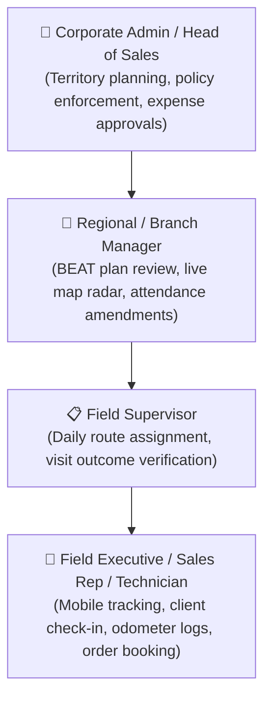

# Competitor Product Audit: Unolo

**Platform Analyzed:** Unolo ([unolo.com](https://unolo.com))  
**Entity:** SmartSense Technologies Pvt. Ltd. (Gurugram, Haryana, India)  
**Package Identifier (Android):** `smartsense.co.in.sensephone`  
**Date of Audit:** October 15, 2026  
**Evidence Standard:** Primary documentation, official Freshdesk knowledge base, video walkthroughs, and Play Store package metadata  

---

> [!IMPORTANT]
> **Post-Audit Verification Addendum (October 2026):**  
> An adversarial audit verified that Unolo officially implements **Shift-Based Auto Tracking** ([unolo.com/locationtracking](https://unolo.com/locationtracking)). Location tracking strictly starts on attendance punch-in and ceases on attendance punch-out. Employee privacy complaints observed in public app reviews stem from Android OS `ACCESS_BACKGROUND_LOCATION` "Allow all the time" permission dialogs, failed auto-punchouts, and employer policy misconfiguration rather than an unconstrained 24/7 tracking architecture. Default update frequency is verified at **5 minutes (configurable)**. See [12-EVIDENCE-VALIDATION-REPORT.md](./12-EVIDENCE-VALIDATION-REPORT.md) for full evidence details.

---

## 1. Product Positioning & Commercial Model

### 1.1 Market Positioning
Unolo is a specialized **Field Force Management (FFM) and Field Force Automation (FFA)** platform. Unlike general task software, Unolo is purpose-built from the ground up for mobile workforces operating outside the office.

* **Target Verticals:** FMCG field sales, pharmaceutical medical reps, retail distribution, logistics & dispatch, and onsite maintenance services.
* **Core Philosophy:** "Accountability, verification, and automated conveyance" — ensuring management knows where field reps are, verifying that client visits actually occurred, and automating travel expense reimbursement based on calculated GPS distance.

### 1.2 Subscription Packaging & Commercial Structure
Unolo operates on a modular per-user, per-month SaaS tier:
* **Entry / Basic Plan:** Approximately **$4 / user / month** (~₹300–₹350/user/mo) covering baseline GPS tracking and attendance.
* **Standard / Advanced Plan:** Includes BEAT route planning, client site geofencing, custom field forms, and travel distance calculation.
* **Enterprise Plan:** Includes ERP/HRMS API integrations, Unolo Facelock biometric recognition, and automated travel expense workflows.
* **Evaluation Model:** 14-day free trial (no credit card required).

---

## 2. Organization Topology, Roles & Field Hierarchy

---

## 3. Module-by-Module Functional Deep Dive

### A. Task & Field Visit Management
* **BEAT Planning & PJP (Permanent Journey Plans):** Managers configure recurring weekly or monthly customer route sequences (e.g., visit Retailer X every Monday, Retailer Y every Thursday).
* **Task Initiation ("Press & Hold"):** Mobile executives view assigned client visits on a map grid and must perform an intentional "Press & Hold" interaction to start a task, preventing accidental triggers.
* **Order & Target Booking:** Built-in mobile order-taking module where field reps can select items from a product catalog, apply tax rules, and submit client purchase orders directly from the field.

### B. Attendance & Workforce Management
* **Unolo Facelock:** Proprietary facial recognition authentication on mobile check-in to completely eliminate proxy attendance.
* **Geofenced & Auto-Attendance:** Ability to automatically clock an employee in or out when their mobile coordinates cross a predefined geofence boundary (e.g., regional office or customer facility).
* **Attendance Amendments:** Formal employee exception request pipeline when network failure or device battery depletion prevents normal punch-out.

### C. GPS Location & Field Tracking Engine (Core Strength)
* **High-Precision Background Tracking:** Uses Android `FOREGROUND_SERVICE_LOCATION` and `ACCESS_BACKGROUND_LOCATION` to maintain persistent tracking even when the app is minimized or the screen is locked.
* **Configurable Sampling Intervals:** Dynamic ping intervals (typically configurable from 3 to 15 minutes, defaulting to 5 minutes) balancing coordinate density against device battery drain.
* **Route Playback & Timeline:** Interactive historical map view visualizing the field rep's exact breadcrumb trail, stops, transit durations, and speed profiles.
* **Fraud & Spoofing Detection:**
  - Mock Location Detection: Identifies and flags third-party mock GPS / fake-location developer apps.
  - Companion Travel Detection: Flags anomalous instances where multiple sales reps generate identical GPS paths while claiming independent vehicle travel.

### D. Travel Distance & Odometer Conveyance Engine
* **Odometer Verification Workflow:**
  1. Field executive enters initial vehicle odometer numerical value on shift start.
  2. Mandatory camera capture of the physical dashboard odometer.
  3. Continuous background GPS distance accumulation during shift.
  4. End-of-shift final odometer photo and numerical entry.
* **Conveyance Automation:** Compares claimed odometer difference against server-calculated GPS distance to detect fraudulent fuel reimbursement claims.

### E. Proof of Work & Custom Form Engine
* **Site Geofence Enforcement:** Prohibits technicians from submitting completion forms if their physical mobile coordinates are outside the client's geofenced radius (e.g., >100m).
* **Dynamic Form Builder:** Supports custom checkboxes, numerical inputs, photographic proofs, and client digital signatures.

### F. Analytics, Dashboards & Integrations
* **Real-Time Live Radar Map:** Web dashboard categorizing technicians into *Active (moving)*, *Idle (stationary at site)*, *Offline (network loss)*, and *Inactive (punched out)*.
* **HRMS & Payroll Bridges:** Pre-built webhooks and CSV export formats for popular Indian and global HRMS platforms (e.g., Darwinbox, Keka, GreytHR).

### G. Mobile & Offline Architecture
* **Local SQLite Cache:** Caches location pings and completed visit forms in local mobile storage during rural or dead-zone travel; automatically flushes to the server upon network reconnection.
* **Aggressive Battery Management:** Requires users to manually disable OEM battery optimizations (MIUI, ColorOS, OxygenOS battery savers) to prevent background tracking termination.

---

## 4. Key Strengths & Critical Vulnerabilities

### Unolo Strengths:
1. **Industry-Leading Field Mileage & Expense Automation:** Solves the #1 operational pain point for Indian field teams — fraudulent conveyance claims.
2. **Robust BEAT / PJP Route Scheduling:** Unmatched operational structure for high-frequency retail distribution and sales routes.
3. **Deep Android Sensor Optimization:** Advanced handling of background service lifecycles, accelerometer activity recognition, and mock-location detection.

### Critical Vulnerabilities & Architectural Gaps:
1. **Severe Employee Pushback & Privacy Resistance:** Unolo's aggressive continuous surveillance model and off-duty tracking controversies frequently cause friction with field technicians.
2. **Heavy Battery Drain:** Continuous GPS polling and foreground services rapidly drain phone batteries, creating tension between field reps and management.
3. **Sales/ERP Bloat:** Heavy emphasis on order booking, product catalogs, and sales targets dilutes its utility for pure field engineering, task maintenance, and operational service workflows.
4. **Complex Pricing & Setup:** Modular pricing structure escalates total cost when tracking, forms, Facelock, and expense modules are combined.
