# Competitor & Oprino Workflow Reconstruction

**Document:** End-to-End User Experience & Operational Flow Analysis  
**Auditor:** Senior UX Research Lead & SaaS Product Architect  
**Date:** October 15, 2026  

---

## 1. Workflow 1: Owner Creates Organization & Workspace

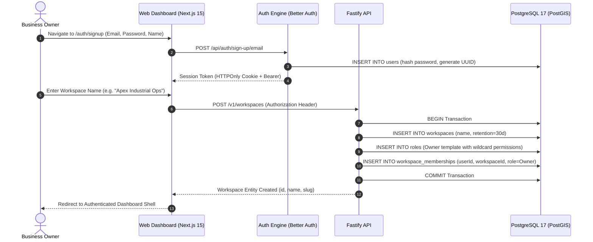

* **Actor:** Business Owner (`roles.name = 'OWNER'`).
* **Validation & Rules:** Workspace creation must be atomic. If role generation fails, entire workspace is rolled back.
* **Competitor Comparison:**
  - *TaskOPad:* Requires company phone number, department name, and triggers WhatsApp OTP verification during onboarding.
  - *Unolo:* Requires corporate email domain verification and prompts for fleet size (1–10, 11–50, 50+).

---

## 2. Workflow 2: Owner Onboards & Invites Employees

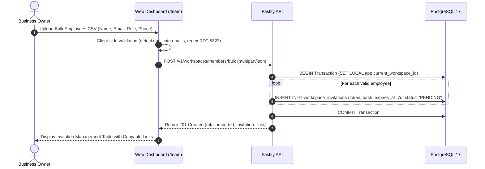

* **Actor:** Owner / Admin (`members.invite`).
* **Business Rule (BLK-002/003):** Invitation tokens are hashed with SHA-256 in the database; single-use only; expire in 7 days.
* **Competitor Comparison:**
  - *TaskOPad:* Sends direct WhatsApp template message with employee credentials.
  - *Unolo:* Sends SMS with deep link to install `smartsense.co.in.sensephone` from Google Play.

---

## 3. Workflow 3: Manager Creates and Assigns Task with Checklists

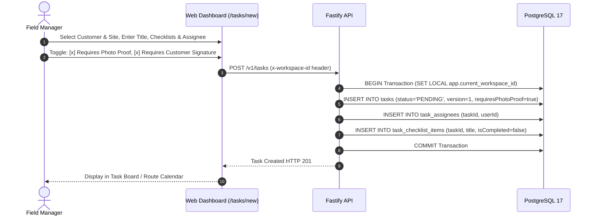

* **Actor:** Manager (`tasks.create`).
* **Business Rule:** Optimistic Concurrency Control (OCC) initialized with `version = 1`.

---

## 4. Workflow 4: Employee Receives Assignment & Views Schedule

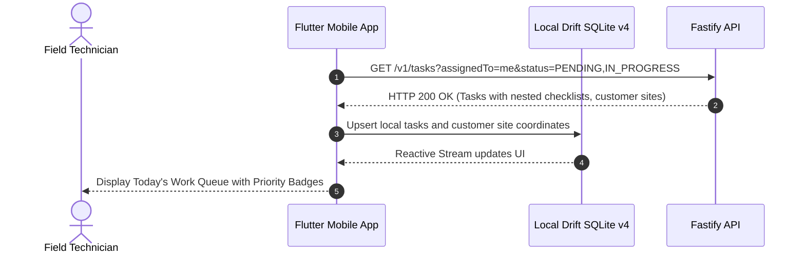

* **Offline Fallback:** If internet is unavailable, Mobile reads directly from cached Drift SQLite tables without blocking user.

---

## 5. Workflow 5: Employee Starts Duty & Records Selfie Attendance

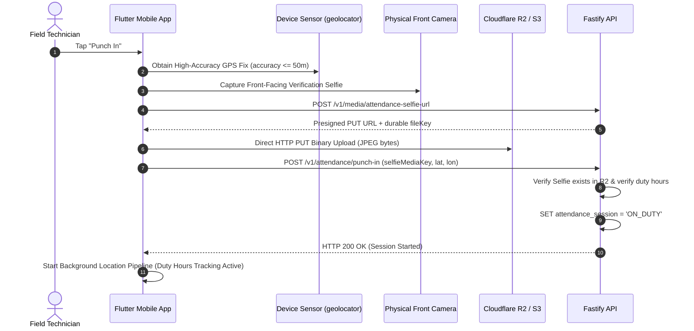

* **Core Privacy Invariant:** Tracking begins **strictly after** authoritative server confirmation of `punch-in`.
* **Competitor Comparison:**
  - *Unolo:* Uses Unolo Facelock to match biometric embeddings locally or via cloud ML.
  - *TaskOPad:* Verifies whether location falls within office geofence.

---

## 6. Workflow 6: Dispatch Stop Sequencing & Travel to Customer Site

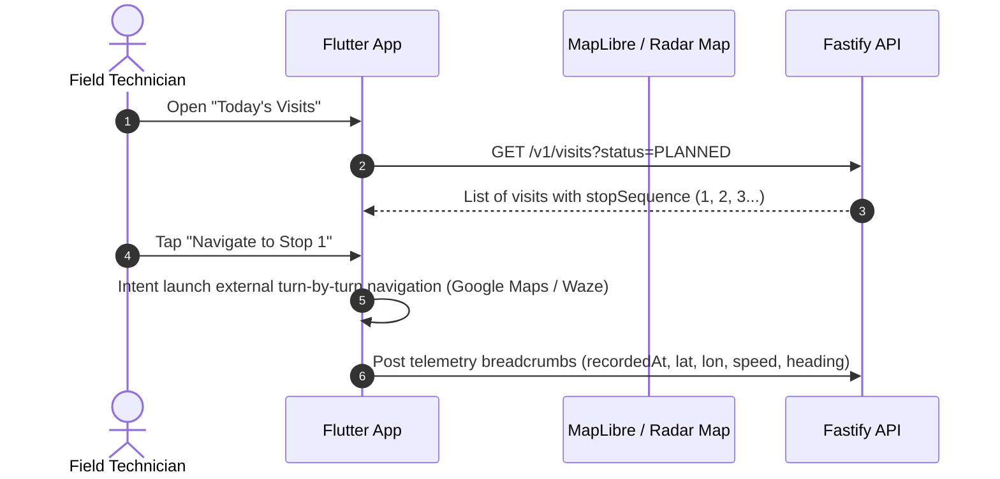

---

## 7. Workflow 7: Employee Performs Geofenced Check-In at Site

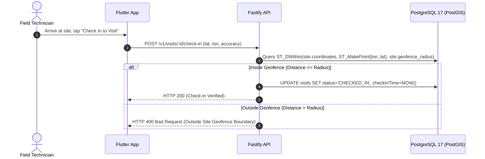

* **Competitor Invariant (Unolo):** Unolo blocks form submission entirely if outside geofence. Oprino enforces this boundary at API layer.

---

## 8. Workflow 8: Mandatory Checklists & Proof of Work Capture

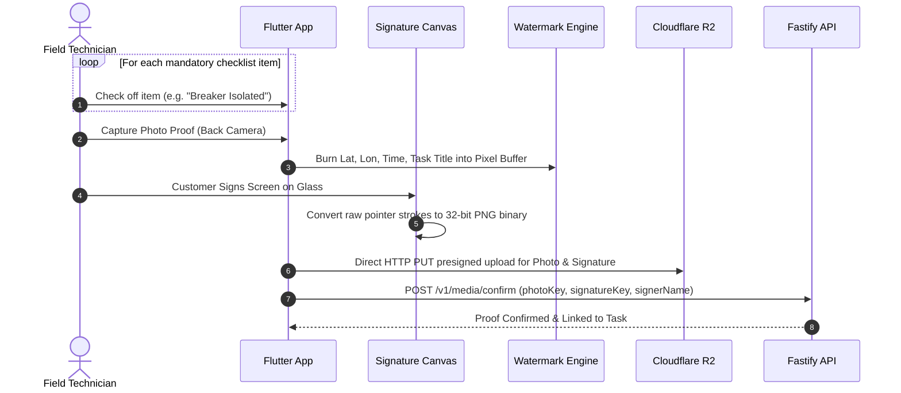

---

## 9. Workflow 9: Task Transition to COMPLETED

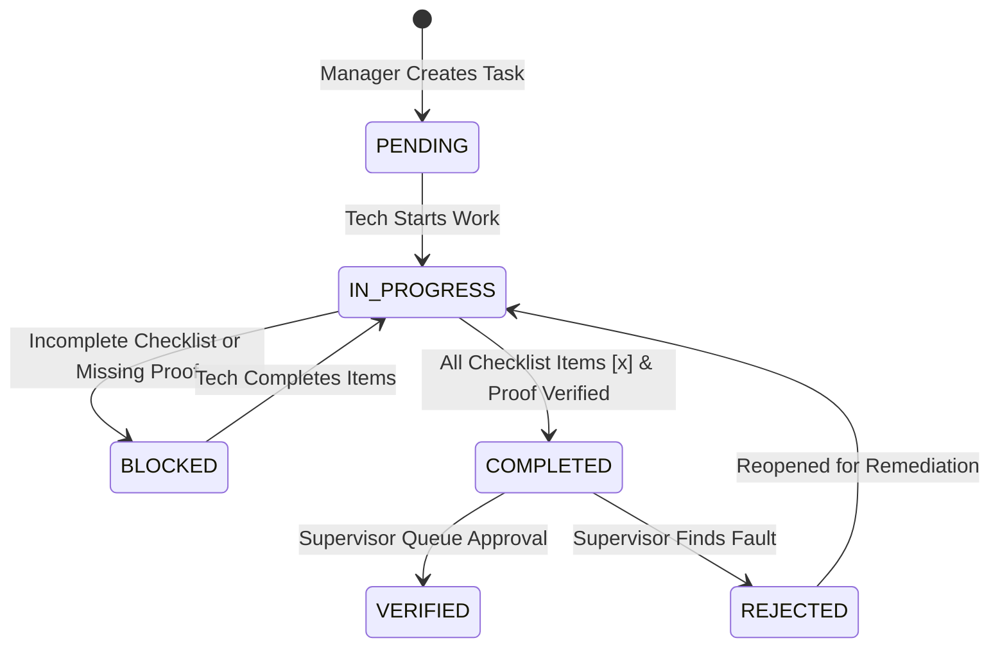

* **Mandatory Completion Invariant:** The API strictly verifies:
  `SELECT count(*) FROM task_checklist_items WHERE task_id = :id AND is_completed = false;`
  If count > 0, HTTP 400 is returned: *"All mandatory checklist items must be completed before marking task as completed."*

---

## 10. Workflow 10: Supervisor Review & Verification Queue

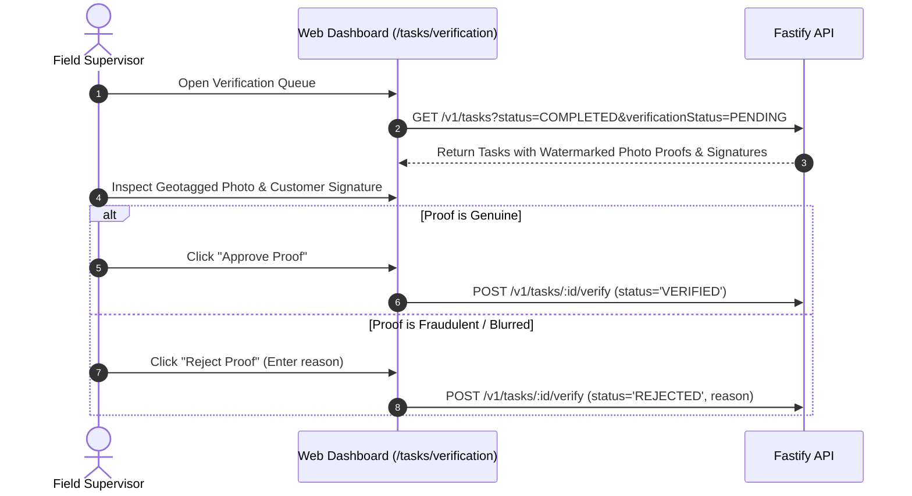

---

## 11. Workflow 11: Shift End, Punch-Out & Privacy Cutoff

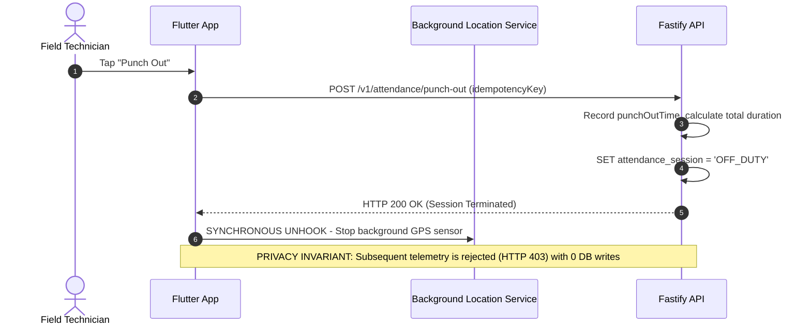

---

## 12. Workflow 12: Offline Operation & Durable Synchronization

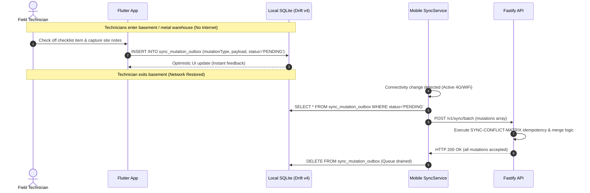
